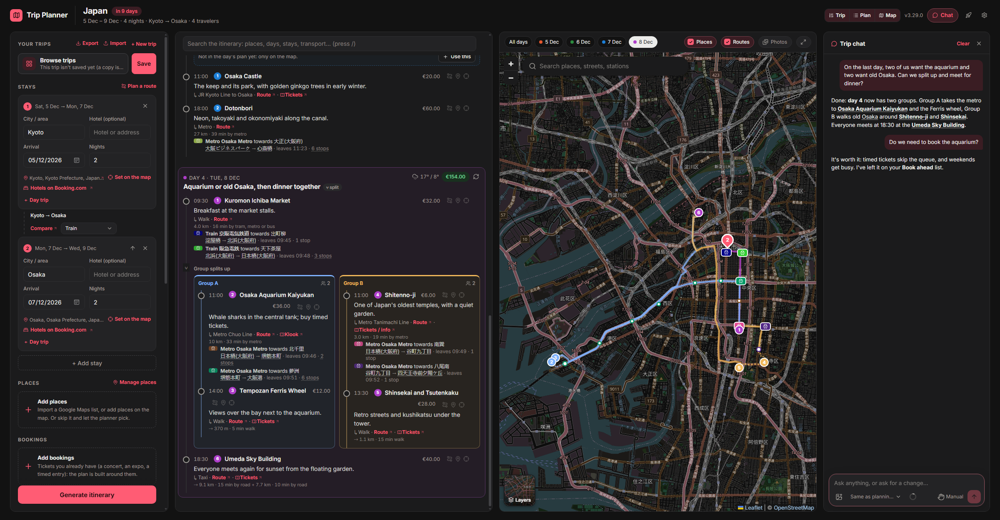

# Local Trip Planner

A day-by-day trip planner that runs on your own computer. Enter where you're staying, bring in the places you'd like to see, and it plans every day: real places, opening hours, costs, public holidays and routes on a live map. Then change it in a chat, plan it together with others, put your photos on its map, print it, or take it along as one offline file on your phone.

It plans with **Claude** through your own [Claude Code](https://claude.com/claude-code) login, with a **local model** (Ollama, LM Studio and other local servers), or with **Claude, GPT and other cloud models** through your own API key. The planner has no accounts and no server of its own: your trips stay on your computer unless you sync them through a folder.



## What it does

**Planning**
- **Any destination.** The country comes from your stays; dates chain together and every stay is placed on the map (or on the exact spot you pick).
- **Real places, not invented ones.** Sights and restaurants around each stay come from OpenStreetMap and go into the plan with their exact location.
- **Research online.** The model looks up opening hours, prices, events and connections while it plans.
- **Planned around you.** Budget, pace, fitness, when your days start, breakfast, public transport or car, your wishes and notes, and what you've already booked (tickets, a concert, an expo).
- **Checked before you see it.** Stops in the wrong town or closed at the planned time (holidays included) go back to the model to be fixed. A review shows the problems, duplicates among them, next to their days.
- **Plan a route.** Describe the trip ("a road trip through the Alps, lakes and old towns") and get a route of stays, with day trips and stops on the way, on a map; change it in its chat.

**Your places**
- **Google Maps lists.** Import lists by share link or Takeout CSV. Tick the lists to show on the map, and switch on **Suggest** for the ones the planner may pick from.
- **Must-sees and skips.** Star what you must see (for the whole group or some of you), say whether it's on the way or from a stay, and skip what you don't want. The Places window shows everything as a table to sort and filter.

**The trip chat**
- Ask anything about the trip: what's on a day, where to eat, what to book. Answers list their sources, and distances and driving times are looked up.
- Ask for a change ("make day 4 more relaxed", "Hohenwerfen on the way, not as a day trip"). In **Ask** mode it only answers, in **Manual** a change waits for **Apply**, in **Auto** small edits happen straight away. Only the days a change touches are re-planned, **Review** compares before and after, and **Undo** puts everything back.
- It can change stops, days, stays, travelers and budget, bookings, the packing list, and where a stop really is.
- It asks you rather than guessing, with answers to pick from.
- Send a picture of a place you don't know, and it works out what it is (and adds it if you ask).
- It shows its thinking, can use a different model than the planner, and summarizes long conversations.

**The plan**
- **Split days.** When the group splits up, each group gets its own column, stop numbers and line on the map, also when a group splits again.
- **Getting there.** Travel days show the journey from hotel to hotel. Public transport legs list each ride from the timetable: line, direction, where to get on and off, and departure. Each stop links to directions in Google Maps, Apple Maps or Bing Maps.
- **Every stop editable.** Time, name, cost, booking, website, how you get there and who goes. Re-plan a single day or a whole stay, and search the whole itinerary.
- Costs per stop and day against a budget per person, with a breakdown; a fuel estimate for the drives (or electricity for an electric car); public holidays and events; a weather forecast close to the trip; a "Book ahead" checklist and a packing list.

**The map**
- Walking, cycling and driving legs follow real paths and roads; trains, trams, metros, buses, boats and cable cars follow their routes.
- Search places, streets and stations as in a maps app, or everything of a kind in view ("McDonald's in this area", toilets, ramen), and add what you find.
- Place names in the local language or in English. The **Layers** button switches your stays, routes, saved places and photos, and (switched on in Settings) every transport line from OpenStreetMap.
- Hide any of the columns, give the map the whole window, or use it on a phone one section at a time.

**Photos**
- Show the photos and videos of folders on your computer or in Google Drive on the map, where each was taken, and in a gallery by day of the trip.
- Photos without a location are placed by their time, or by hand: drag them onto the map. Your files aren't changed.
- **Preview** shows the trip in pictures, day by day, with a slideshow.

**Take it with you**
- **For phone:** one offline HTML file with the map and the days. **Calendar:** every stop in your calendar (.ics). **Print / PDF:** a clean printout with a cover page.
- **Share a trip:** export it as a file that someone else imports.
- **Phone access:** Settings → Phone serves the planner on your home network behind a secret link with a QR code (away from home through Tailscale), and the open trip stays in step.

## Planning together

Trips can sync through shared folders in **Google Drive** or **Dropbox**, or through a folder on your computer (a network drive, or one that OneDrive or iCloud keeps in step). Add folders in Settings → Sync, your own or ones friends shared with you, and pick per trip where it syncs to.

- Your other computers and your friends get the trip in **Your trips**, and changes go both ways. Whoever shared it decides whether others can edit or only view it.
- Changes others make arrive while the trip is open, with a note of who changed what, **Review** and **Undo**. A history shows every change, and each part of the trip says who changed it last.
- Changes to different things are joined. Where two of you changed the same thing, yours stays, theirs is kept, and you can switch to it.
- Your trip chat and your own settings stay yours. Nothing is ever deleted in a sync folder.

Google Drive and Dropbox use your own free app, set up once with the guide in Settings → Sync ([Google Drive](docs/google-sync.md), [Dropbox](docs/dropbox-sync.md)). Folders on your computer need nothing.

## Download

Get the latest version from the [Releases page](https://github.com/notetuwu/trip-planner/releases/latest). Nothing else needs to be installed.

| System | File |
| --- | --- |
| Windows | `…-windows-x64-setup.exe` (installs without admin rights), or `…-windows-x64-portable.zip` (unzip anywhere and run `Trip Planner.exe`) |
| macOS | `…-macos-arm64.zip` (Apple Silicon) or `…-macos-x64.zip` (Intel): unzip and move it to Applications |
| Linux | `…-linux-x64.tar.gz`: unpack and run `trip-planner` |

The app isn't code-signed yet, so the first start shows a warning. On Windows click **More info → Run anyway**; on macOS right-click the app and choose **Open**.

It opens in a window of its own (or a browser tab: Settings → General) and keeps your trips in `%APPDATA%\Trip Planner` (Windows), `~/Library/Application Support/Trip Planner` (macOS) or `~/.local/share/trip-planner` (Linux). When a new version is out, a bar at the top offers it; on Windows **Update now** installs it and restarts. Settings → Updates has **Check now**, can turn the check off, and lists what changed in every version (it opens by itself once after an update). On Windows each older version there has **Roll back**, which keeps a copy of your data and installs that version.

On the first start a **Quick start** guide opens (the rocket next to Settings brings it back): it checks for Claude Code, API keys, Ollama and its models, Docker and SearXNG, shows what's ready and what's missing, takes API keys right there and links to where the rest is set up.

**Your trips** keeps every saved trip as a card with a map of its route, or in a table: search by name, town, country or year, filter by where it is and who shared it, sort by date, name or length, and open, copy, rename or delete. The open trip saves itself as you change it, earlier versions are kept, and **Recover** brings them back.

## Choosing a model

Pick one from the **Model** menu (it only offers Claude when Claude Code is installed). You need one of these:

- **Claude Code**, installed and logged in. Plans count toward your Claude plan, with no API charges.
- **An API key** from [Anthropic](https://console.anthropic.com/settings/keys), [OpenAI](https://platform.openai.com/api-keys) or [OpenRouter](https://openrouter.ai/keys), added in Settings → API keys. You pay the provider per use; the key stays on your computer.
- **A local model.** Settings → Local models installs [Ollama](https://ollama.com) (on Windows; elsewhere it gives you the command), suggests current models that fit your graphics card and installs them with a progress bar. LM Studio, llama.cpp, Jan, KoboldCpp, GPT4All and vLLM are found automatically too.

Local models are free and private but slower and less thorough on long trips; bigger models plan better. The planner helps them along: real places in the prompt, its own web research for them, checks afterwards, and if a model stops part way through a long trip, it keeps the finished days and asks only for the rest. Settings → Planning also has an experimental **step by step** mode for local models (an outline of the days, research for those days, then each day on its own), for when planning in one go gets cut off.

**Settings → Planning** fine-tunes how plans are made: the language, how much the descriptions say, how many real places go into the prompt, the number of web lookups, fix rounds, and for local models thinking, creativity and how long the model stays loaded. Local models' research can use [Brave Search](https://brave.com/search/api/) (free plan, most reliable) or your own [SearXNG](https://docs.searxng.org) (which the app can set up for you in Docker, step by step, and remove again; with SearXNG chosen, Docker and it are started with the app), instead of DuckDuckGo and Wikipedia.

## Run from source

Needs [Node.js](https://nodejs.org) 22.12 or newer (and Python 3 for `start.py`).

```sh
python start.py            # installs, builds if needed, starts it and opens http://localhost:5173
python start.py --dev      # with hot reload while you change the code
```

Or `npm install`, `npm run build` and `npm start`. Run from source, trips are kept in `saves/`, place lists in `lists/` and lookups in `cache/`, all git-ignored. After pulling changes, restart it so the server picks them up.

## Configuration

Everything has a setting in the app; these environment variables are optional:

| Variable | What it does |
| --- | --- |
| `PORT` | Port to listen on (default `5173`) |
| `CLAUDE_BIN` | Path to the `claude` CLI, if it isn't found automatically |
| `ANTHROPIC_API_KEY`, `OPENAI_API_KEY`, `OPENROUTER_API_KEY` | API keys (or add them in the app); also read from a `.env` file |
| `ANTHROPIC_BASE_URL`, `OPENAI_BASE_URL`, `OPENROUTER_BASE_URL` | Send API requests through a proxy or compatible endpoint |
| `OLLAMA_URL` | Ollama's address (default `http://127.0.0.1:11434`) |
| `LOCAL_LLM_URLS` | More OpenAI-compatible servers to look for, comma-separated |
| `OLLAMA_NUM_CTX` | The most context Ollama is given (default 128k; Settings → Local models can fix it) |
| `BRAVE_API_KEY`, `SEARXNG_URL` | Search for local models' research (also in Settings → Planning) |
| `GOOGLE_API_KEY` | A free Google API key for photo folders in Drive shared by link (also in Settings → API keys) |
| `GEOAPIFY_API_KEY` | A free Geoapify key: a faster third place search for long lists of saved places (also in Settings → Planning) |
| `RESEARCH_MAX_LOOKUPS` | Most searches and page reads in one research round (default 30) |
| `TRIP_PLANNER_DATA` | Another folder for trips, place lists and caches |
| `PLACES_CSV` | A CSV of places to import on startup |
| `TRIP_PLANNER_NO_UPDATES` | `1` turns off the update check |
| `DROPBOX_APP_KEY` | Your Dropbox app's key for syncing trips through Dropbox (or enter it in Settings → Sync; see [docs/dropbox-sync.md](docs/dropbox-sync.md)) |
| `GOOGLE_CLIENT_ID`, `GOOGLE_CLIENT_SECRET` | Your Google client for syncing trips through Drive (or enter it in Settings → Sync; see [docs/google-sync.md](docs/google-sync.md)); also read from a `.env` file |

## Services it uses

The app runs locally but calls these public services, free or with your own free key. Please keep use personal and moderate; requests are rate-limited and cached on purpose. Settings → Credits lists them all with their licences.

- [Nominatim](https://nominatim.org) and [Photon](https://photon.komoot.io): finding places. [Overpass API](https://overpass-api.de): sights and restaurants around each stay.
- [OSRM](https://project-osrm.org) and [FOSSGIS routing](https://routing.openstreetmap.de): walking, cycling and driving routes. [Transitous](https://transitous.org): public transport routes and timetables.
- [OpenStreetMap](https://www.openstreetmap.org) and [OpenFreeMap](https://openfreemap.org) tiles; Esri World Street Map in the phone file.
- [Nager.Date](https://date.nager.at): public holidays. [Open-Meteo](https://open-meteo.com): weather. [Wikipedia, Wikivoyage and Wikidata](https://www.wikimedia.org): research when no web search is set up.
- [Frankfurter](https://frankfurter.dev): exchange rates. [fuel-prices.eu](https://www.fuel-prices.eu), [Natural Resources Canada](https://natural-resources.canada.ca), the [Australian Institute of Petroleum](https://aip.com.au) and the [US EIA](https://www.eia.gov): fuel prices.
- Optional: [Geoapify](https://www.geoapify.com) (faster place search), Google Drive and Dropbox (sync; Drive also for photo folders), [Wikimedia Commons](https://commons.wikimedia.org) (pictures in the preview).

Map data © OpenStreetMap contributors. The Google Maps list import uses the same unofficial endpoint as a list's share page and can break when Google changes it; lists imported by link come with exact locations, while a [Takeout](https://takeout.google.com) CSV always works but needs every place looked up.

## How it's built

A TypeScript app built with [Vite](https://vite.dev), with [Leaflet](https://leafletjs.com) (and [MapLibre](https://maplibre.org) for English map labels), [Lucide](https://lucide.dev) icons and [qrcode-generator](https://github.com/kazuhikoarase/qrcode-generator), and no UI framework. The server is plain Node in TypeScript; its only dependencies are the Anthropic SDK and the `opening_hours` parser. When you generate, the server gathers holidays and nearby places, builds one detailed prompt and runs it through Claude Code, an API or the local server, streaming progress back to the page.

```
web/src/     the page: core, trip, places, geo, map, itinerary, generate, setup, settings, export, saves, styles
server/      the server: api.ts and routes/, ai/ (prompt, runners, chat), research/, geo/, trip/, lists/, sync/, update/
shared/      types used by both
tests/       unit tests (Vitest) and browser tests (tests/e2e)
scripts/     packaging into one executable per system
packaging/   icon and the Windows installer script
```

## Development

```sh
npm run dev         # dev server with hot reload (the API runs inside it)
npm run typecheck   # TypeScript checks
npm test            # unit tests
npm run build       # production build into dist/
npm run e2e         # browser tests against dist/ (headless Chrome or Edge; CHROME_PATH to pick one)
npm run package     # the app as one executable for this system, in release/
```

`npm run package` bakes the server and the page into a copy of Node ([single executable application](https://nodejs.org/api/single-executable-applications.html)). GitHub Actions runs the checks and tests on every push, and builds the releases for Windows (zip and [Inno Setup](https://jrsoftware.org/isinfo.php) installer), macOS and Linux when a version tag is pushed.

## Privacy

Everything runs on your computer: see [PRIVACY.md](PRIVACY.md).

## License

[MIT](LICENSE)
